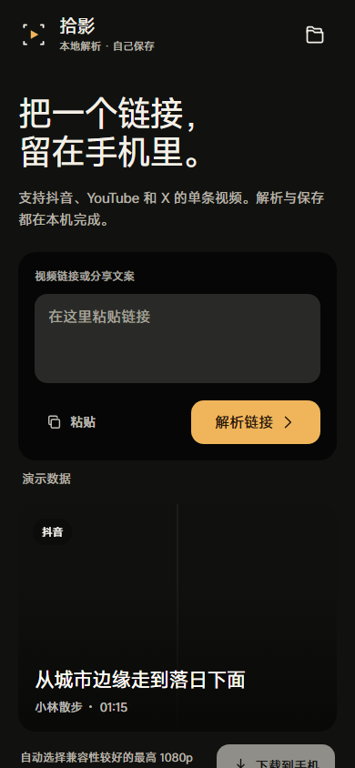

# 拾影 Android / ShiYing Android

一个本地优先的 Android 媒体保存工具。粘贴一个抖音作品、YouTube 视频或 X/Twitter 视频链接，在手机上解析并保存到本地。

> 本项目按 GPL-3.0 开源。运行解析、媒体合并和文件写入都发生在设备上，不依赖自建解析服务器。



## 功能

- 识别分享文案中的抖音、YouTube 和 X 链接。
- 抖音视频使用本地解析模块，不调用第三方解析网站。
- 抖音图集支持无水印原图批量保存。
- YouTube 和 X 使用 APK 内嵌的 Python、yt-dlp 和 FFmpeg。
- 解析结果展示标题、作者、时长、封面和图片数量。
- 前台下载、进度、取消、失败重试和本地下载历史。
- 视频保存到 `下载/ShiYing`。
- 图片保存到 `图片/ShiYing`。
- 支持浅色/深色系统主题、字体缩放和沉浸式系统栏。
- 不包含账号、云同步、统计 SDK 或自建后端。

## 平台限制

- 支持 Android 8.0（API 26）及以上。
- 当前发布包仅包含 `arm64-v8a`。
- 支持抖音单条视频和图集。
- YouTube、X 只支持单条视频；不支持播放列表、主页或搜索页。
- 需要登录、地区限制或平台风控验证的内容可能失败。
- YouTube/X 在部分网络环境需要系统代理。
- 平台页面和接口变化可能导致解析失效。

链接访问需要网络；解析、合并和保存在本机完成，下载后的媒体可以离线使用。

## 安装

从本仓库的 GitHub Releases 下载：

```text
ShiYingAndroid-arm64.apk
```

在 Android 手机上允许当前文件管理器安装未知来源应用，然后打开 APK。新版本可直接覆盖安装；升级时请保留同一签名密钥。

## 构建

要求：

- JDK 17
- Android SDK Platform 35
- Android Build Tools 34.0.0
- Gradle 8.9（可使用仓库自带 wrapper）

设置环境变量：

```powershell
$env:JAVA_HOME = "<JDK-17-path>"
$env:ANDROID_HOME = "<Android-SDK-path>"
```

构建并测试：

```powershell
.\gradlew.bat testDebugUnitTest
.\gradlew.bat assembleRelease
```

Windows 上如项目路径包含中文，`HttpURLConnection` 本身不受影响，但 Gradle 单元测试进程可能无法从非 ASCII 路径加载测试类。可使用 ASCII 目录 junction 运行测试。

也可运行发布脚本：

```powershell
.\build-release.ps1 -JavaHome $env:JAVA_HOME -AndroidHome $env:ANDROID_HOME
```

输出：

```text
dist\ShiYingAndroid-arm64.apk
```

## 签名

发布脚本会优先读取以下环境变量：

```text
SHIYING_STORE_PASSWORD
SHIYING_KEY_PASSWORD
SHIYING_KEY_ALIAS
```

首次构建时，如果 `shiying.keystore` 不存在，脚本会生成本地签名文件。`shiying.keystore` 和 `keystore.properties` 已被 Git 忽略，绝不能提交到仓库。

## 测试

UI 模型测试：

```powershell
npm test
```

Android 单元测试：

```powershell
.\gradlew.bat testDebugUnitTest --rerun-tasks
```

自动测试覆盖：

- 分享文本和平台链接归一化
- 下载状态转换
- 抖音短链重定向
- 抖音 `ttwid` 分享页握手
- 抖音视频和图集 HTML 解析
- 文件名和临时目录边界
- 本地 HTTP 文件下载
- MediaStore 视频/图片元数据

## 项目结构

```text
app/src/main/java/com/hang/shiying/
├─ bridge/       JavaScript ↔ Android bridge
├─ core/         链接、错误、媒体模型和任务状态
├─ extractor/    抖音解析、yt-dlp 适配器
├─ data/         SQLite 下载记录
├─ download/     前台下载服务
└─ storage/      MediaStore 保存

app/src/main/assets/www/
└─ 完全打包在 APK 内的本地 HTML/CSS/JS 界面
```

## 数据与隐私

- 下载历史保存在 App 私有 SQLite 数据库。
- 不包含统计 SDK、广告 SDK、远程配置或自建解析服务器。
- Android 10 及以上不申请“所有文件访问权限”。
- 应用不会在公开日志中写入完整分享链接。
- 用户 Cookie 不在首版支持范围内。

## 第三方项目与技术

本项目能够运行，依赖或参考了以下开源项目。完整声明见 [NOTICE](NOTICE)，参考项目的 MIT 许可证全文见 [third_party/Jaqennn-ShiYing-MIT.txt](third_party/Jaqennn-ShiYing-MIT.txt)。

### 核心运行组件

- [youtubedl-android](https://github.com/yausername/youtubedl-android) — Android 端 Python/yt-dlp 运行封装，GPL-3.0。
- [yt-dlp](https://github.com/yt-dlp/yt-dlp) — YouTube/X 媒体提取器，Unlicense。
- [Python](https://www.python.org/) — 嵌入式 Python 运行时，Python Software Foundation License。
- [FFmpeg](https://ffmpeg.org/) — 音视频合并和媒体检查，LGPL/GPL，具体取决于随包构建配置。
- [QuickJS](https://bellard.org/quickjs/) — yt-dlp 运行时使用的 JavaScript 引擎，MIT。
- [ytdlp-lazy](https://github.com/xibr/ytdlp-lazy) — youtubedl-android 的 yt-dlp 打包辅助项目。

### Android 依赖

- [AndroidX](https://developer.android.com/jetpack/androidx) — Apache-2.0。
- [Kotlin standard library](https://kotlinlang.org/) — Apache-2.0。
- [Jackson](https://github.com/FasterXML/jackson) — Apache-2.0。
- [Apache Commons IO](https://commons.apache.org/proper/commons-io/) — Apache-2.0。
- [Apache Commons Compress](https://commons.apache.org/proper/commons-compress/) — Apache-2.0。
- Guava ListenableFuture 和 JetBrains Annotations — Apache-2.0。

### 参考项目

- [Jaqennn/ShiYing](https://github.com/Jaqennn/ShiYing) — 本项目参考了其架构思路和抖音分享页解析方案，MIT License。拾影 Android 是独立实现，并非该项目的官方 Android 版本。

### 构建与测试工具

- Gradle、Android Gradle Plugin、Robolectric 和 AndroidX Test — Apache-2.0。
- JUnit 4 — Eclipse Public License 1.0。
- org.json — Public Domain。
- Node.js — 用于本地 UI 模型测试，Node.js License。

Douyin、YouTube 和 X/Twitter 是其各自所有者的商标。本项目与这些平台无隶属或官方授权关系。

## 使用声明

请只下载你拥有版权、获得授权，或平台条款允许保存的内容。使用者需要自行遵守平台服务条款和当地法律。项目作者不对第三方内容或平台接口变化负责。

## License

Copyright © 2026 ShiYing Android contributors.

本项目以 **GNU General Public License v3.0** 发布，完整条款见 [LICENSE](LICENSE)。

第三方组件仍分别遵循各自许可证；GPL-3.0 不会改变第三方组件原有的版权归属。
